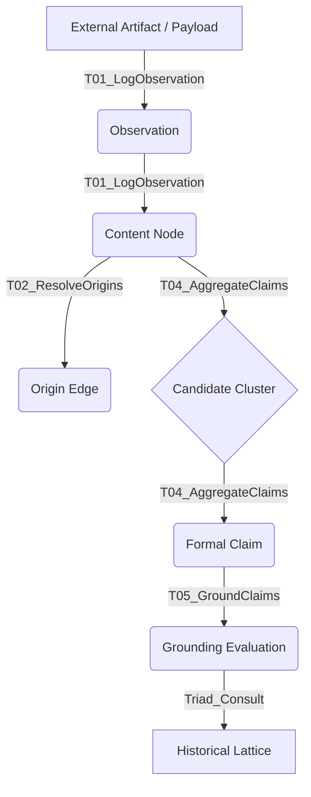

# Axis Admission State Diagram v1

*Status: Working Hypothesis*
*Purpose: Cartographic mapping of the Truth Engine immune filters for historical lineage parsing.*

## The Pipeline

## Confidence Classification

To ensure this map remains falsifiable during historical reconstruction, we classify our confidence in the mapped states based strictly on observed execution:

### High Confidence (Demonstrated)
*   **OBS**: Observation minted from payload.
*   **CNT**: Content Node minted.
*   **CLM**: Claim minted.
*   **Grounding Ledger**: Status and confidence scores computed based on trust buckets.
*   **Triad_Consult behavior**: Queries `TE_Grounding_Ledger` and `TE_Claims_Index`, enforcing strict access.

### Medium Confidence (Inferred from code)
*   **Origin Edge mechanics**: `T02` logic to map child-parent derivation.
*   **Candidate Cluster mechanics**: `T04` logic to cluster `Get-ClaimSignature` matches.
*   **Claim aggregation path**: The exact transition threshold from `CNT` to `CLM`.

### Unverified (Unknowns to hunt)
*   Exclusivity of paths (Are there backdoors to minting claims?).
*   Completeness of paths.
*   Hidden admission routes.
*   Hidden consumers of the ledgers besides `Triad_Consult`.

***

## The Biologist's Questionnaire

**What scripts mint observations?**
- `T01_LogObservation.ps1` (writes to `TE_Observations_Log.jsonl`)

**What scripts mint nodes?**
- `T01_LogObservation.ps1` (writes to `TE_Content_Nodes.jsonl`)

**What scripts write claims?**
- `T04_AggregateClaims.ps1` (mints `CLM-` IDs and writes to `TE_Claims_Index.jsonl`)

**What scripts read claims?**
- `T05_GroundClaims.ps1` (reads claims to compute epistemic status)
- `Triad_Consult.ps1` (reads claims to answer grounding queries)

**What scripts read observations?**
- `T02_ResolveOrigins.ps1` (reads observations to resolve text similarity for edges)
- `T04_AggregateClaims.ps1` (reads observations to compute the `PRIMARY`, `GROWTH`, `IGNORE` bucket support)

**What scripts reference the Historical Lattice?**
- `Triad_Consult.ps1` is the only interface that serves the "Historical Lattice" (by joining the Claim Index and Grounding Ledger).

**Which identifiers propagate across subsystems?**
- `obs_id` (`OBS-*`) connects Observations to Content Nodes.
- `content_id` (`CNT-*`) connects Nodes to Origin Edges and Formal Claims.
- `claim_id` (`CLM-*`) connects Formal Claims to the Grounding Ledger.

**Which ledgers are append-only?**
- `TE_Observations_Log.jsonl` (pure chronological history, no updates allowed).
- `TE_Origin_Map.jsonl` (edges are minted, not deleted).

**Which ledgers are authoritative vs. advisory?**
- **Authoritative:** `TE_Observations_Log.jsonl` and `TE_Content_Nodes.jsonl`. They represent raw physical truth.
- **Authoritative:** `TE_Grounding_Ledger.jsonl`. It dictates epistemic status.
- **Advisory:** Candidate Clusters (transient memory during `T04`).
